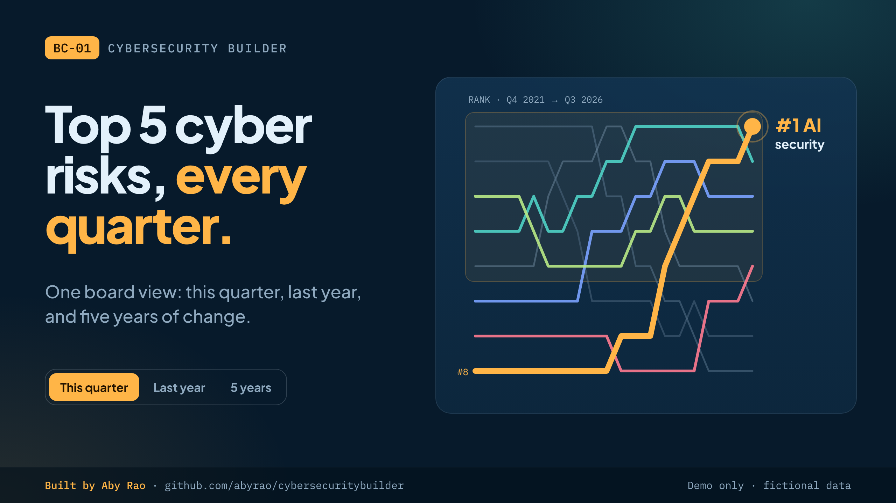

# BC-01 · Quarterly Top 5 Risk Board Update

A dashboard the cybersecurity team prepares each quarter so the board of directors sees the top five cyber risks in the same format every time. It compares them with last quarter, last year, five years of history, a fictional industry benchmark, and the business roadmap.

**For demo purposes only. All data is fictional and does not represent any organization.** Built by Aby Rao.

**Visual scheme:** 8 · Ocean Depth (dark navy, amber accent · Plus Jakarta Sans + IBM Plex Mono)

## How to open

Open `index.html` in any modern browser. It needs no server, no login, and no internet connection; fonts are bundled locally.

## Demo click path

1. **This quarter:** the ranked top five. AI security is #1; Secure code is new. Hover any bar, score, chip, or ring for detail.
2. **Click AI security:** the drawer shows likelihood × impact, us vs. industry, drivers, mitigation, roadmap links, and the 5-year trend.
3. **Last quarter:** AI security moves to #1, Secure code enters, third-party risk drops out.
4. **Last year:** the same view against Q3 2025; the KPI tiles link the climb to the "AI support agents" milestone.
5. **5 years:** press **Play** (or **P**). AI security climbs from #8 to #1 while ransomware and phishing fall away.
6. **About:** live checks, the eight guardrails (hover each), and the AI summary off switch.
7. **Reset** to start over.

**Keyboard:** `1`–`4` switch views · `P` plays the 5-year story · `Esc` closes panels.

## Quality check

Every view, drawer, and presenter mode was checked at 1920×1080 and 1366×768: no overlapping or clipped text, nothing outside its box, no horizontal scroll, and no console errors.

## Files

| Path | Purpose |
|---|---|
| `index.html` | Page structure |
| `css/styles.css` | Visual style |
| `js/data.js` | Fictional data: 8 risks × 20 quarters, indicators, benchmarks, roadmap |
| `js/app.js` | Views, charts, drawers, simulated AI summary, activity log |
| `assets/fonts/` | Plus Jakarta Sans and IBM Plex Mono (SIL Open Font License) |
| `thumbnail/` | Promotional thumbnail (PNG) and its source HTML |
| `REQUIREMENTS.md` | Build requirements this prototype was made from |
