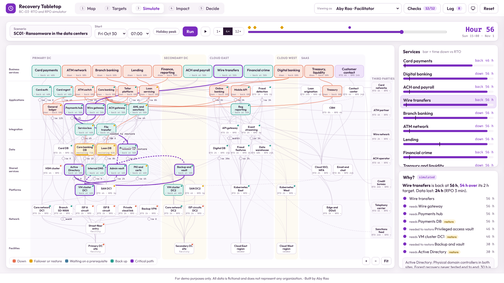

# BC-03 · RTO and RPO Tabletop Simulator

**Build type:** Simulator · **Mindset shift:** Business communication · **Visual scheme:** 9 · Plum & Gold

A tabletop simulator for a fictional regional bank and payments company. It maps how 76 assets across 9 layers and 5 sites hold up 11 business services, puts an RTO and RPO on every one, and runs 20 failure scenarios so leaders can see what goes down, for how long, how much data is lost, and what it costs.

**For demo purposes only. All data is fictional and does not represent any organization.**

## How to open

Open `index.html` in a browser. No server, no login, no network. Fonts are bundled.

## Demo click path (about 90 seconds)

1. **Map (1):** hover **Wire transfers**. Its dependency tree lights up across every layer.
2. **Targets (2):** "8 of 11" services miss on paper. Click **Target inversions**, then **Core banking → Active Directory**.
3. **Simulate (3):** **Scenario** → **SC01 Ransomware**. Start stays Friday 07:00 (payroll Friday, month-end). Watch the failure spread, then drag the clock to hour 56.
4. Click **Wire transfers** on the rail. **Why?** shows the critical path to Active Directory, which has never been tested.
5. **Impact (4):** data lost left of hour 0, time down right; cost to date; the 36-hour regulator clock.
6. **Decide (5):** turn on **Break-glass backup console** and **Rehearse AD forest recovery**. Wires drop from 56 h to 26 h.
7. **Draft memo** → switch **Viewing as** to Dana Whitfield (continuity lead) → **Approve** → **Mark sent**.

Other good scenarios: **SC03** (both HSMs in the primary site), **SC12** (both "diverse" ISPs share one conduit), **SC17** (fraud fail open or closed).

## What's inside

| Path | Purpose |
|---|---|
| `index.html` | Page structure |
| `css/styles.css` | Plum & Gold scheme |
| `js/engine.js` | Recovery engine, cost model, static checks. Pure functions; runs under Node |
| `js/layout.js` | Fixed lane and site layout for the map |
| `js/app.js` | Views, clock, decisions, approvals, memo, checks, log |
| `js/data.js` | Generated from `data/*.json` by `tools/wrap-data.js` (browsers block `fetch()` from `file://`) |
| `data/` | Topology, scenarios, and expected results from the reference model |
| `REQUIREMENTS.md` | Build answers, rules, and known answers |
| `assets/fonts/` | Outfit and Fira Code (SIL Open Font License) |

## Checks

**Checks** in the top bar runs 12 known-answer checks live (K1 to K12 in `REQUIREMENTS.md`). The JS engine also reproduces `data/expected_results.json` for all 20 scenarios exactly.

## Assumptions

* Restores run in parallel once their prerequisites are up; recovery staff limits aren't modeled.
* The scenario calendar is the week of Oct 26, 2026. Holiday peak is a toggle.
* Regulatory clocks are reference markers, not legal advice.
* What-if fixes only project results. The baseline never changes in the demo.
* Third parties are named by role, not by vendor.
