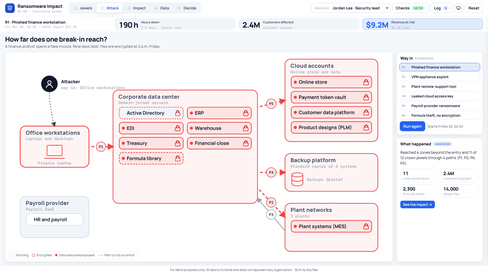

# BC-04 · Ransomware Impact Brief for Executives

**Build type:** Simulator with a one-page report · **Mindset shift:** Business communication · **Visual scheme:** 3 · Glacier

A ransomware simulator for a fictional consumer products manufacturer. It starts from 12 crown jewels and the data they hold, traces how far one break-in reaches, and answers the three questions executives ask first: **how many hours are we down, how many customers are affected, and how much revenue is at risk.** It ends in a one-page brief that a person edits, legal signs off, and the CISO approves.

**For demo purposes only. All data is fictional and does not represent any organization.**

## How to open

Open `index.html` in a browser. No server, no login, no network. Fonts are bundled.

## Demo click path (about 90 seconds)

1. **Jewels (1):** the crown-jewel wall. Hover the dashed **Formula library** card: the core trade secret, not on the list.
2. **Attack (2):** **R1 Phished finance workstation** → **Run**. The break-in spreads zone by zone, 11 of 12 crown jewels lock, data streams out.
3. **Impact (3):** the three numbers fill the strip: **190 h**, **2.4M** customers, **$9.2M** at risk. Drag the clock to hour 86: the payroll file misses its deadline.
4. **Data (4):** what was taken. The formula library's newest clean copy is 41 days old.
5. **Decide (5):** move **Treasury and bank payments** up two places (payroll turns green), then toggle **C3 Isolated immutable backups** (190 h → 98 h).
6. **Draft brief** → switch **Viewing as** to Sam Okafor (General Counsel) → **Legal sign-off** → Priya Natarajan (CISO) → **Approve** → **Send**.

Other good scenarios: **R4** (cloud key: 2.4M customers exposed with only 34 hours down), **R5** (payroll provider: employees paid late), **R6** (formula theft with nothing encrypted; turn on **C5 Formula vault** to stop it at 40 formulas).

## What's inside

| Path | Purpose |
|---|---|
| `index.html` | Page structure |
| `css/styles.css` | Glacier scheme |
| `js/engine.js` | Reach, recovery schedule, impact math, regulatory clocks. Pure functions; runs under Node |
| `js/app.js` | Views, attack animation, timeline, decisions, approvals, brief, checks, log |
| `js/data.js` | Generated from `data/*.json` by `tools/wrap-data.js` (browsers block `fetch()` from `file://`) |
| `data/` | Crown jewels, scenarios, and expected results from the reference model |
| `tools/reference_model.py` | The Python model behind every number in `REQUIREMENTS.md` |
| `tools/check-engine.js` | `node tools/check-engine.js` confirms the JS engine matches the expected results |
| `REQUIREMENTS.md` | Build answers, rules, and known answers |
| `assets/fonts/` | Manrope and IBM Plex Mono (SIL Open Font License) |

## Checks

**Checks** in the top bar runs 12 known-answer checks live (K1 to K12 in `REQUIREMENTS.md`). `tools/check-engine.js` matches the JS engine to the Python model on 19 comparisons, including every scenario.

## Assumptions

* Default start is Fri Nov 20, 2026, 02:00, the week before Thanksgiving. The start can move to Nov 25 or Oct 28; obligations keep their calendar dates.
* Data on a reached system is presumed exposed. Customers are counted once even when several systems hold them.
* Notification, recovery, and plant idle rates are fictional and shown in tooltips.
* Regulatory clocks (SEC 8-K four business days after materiality; 30-day state notice) are reference markers, not legal advice.
* Controls and restore-order changes only project results. The baseline restore order changes only when the COO adopts it.
* Ransom payment, churn, share price, fines, and litigation are not modeled.
