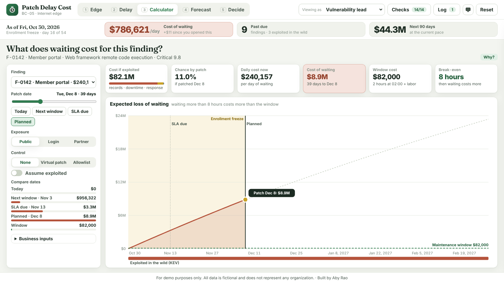

# BC-05 · Patch Delay Cost Calculator for Internet-Facing Systems

Turns "days past SLA" into dollars. For a fictional regional health plan's 16 internet-facing systems, it shows what waiting to patch costs today, what late patching cost last year, and what it will cost next quarter under the current and a proposed policy. It ends in a decision memo and a signed risk acceptance.

**For demo purposes only. All data is fictional and does not represent any organization.** Built by Aby Rao.

**Visual scheme:** 4 · Forest Ledger (sage paper, forest ink, green accent, gold second · Fraunces + Inter)

## How to open

Open `index.html` in any modern browser. It needs no server, no login, and no internet connection; fonts are bundled locally.

## What's inside

* **Edge:** treemap of 16 systems sized by cost if exploited and colored by daily cost of waiting; a drawer with each system's open findings, **Why?**, and **Calculator**.
* **Delay:** monthly cost of delay with the 2025 enrollment freeze shaded; click a month for the findings behind it; days to patch against SLA by severity.
* **Calculator:** drag the patch date on the curve or the slider; change exposure, add a virtual patch or allowlist, assume the finding is exploited, or edit records, cost per hour down, and window hours. Cards show cost if exploited, chance by patch date, daily cost, cost of waiting, window cost, and break-even.
* **Forecast:** 90-day cumulative expected loss for the current policy, the proposed policy, and the proposed policy plus virtual patches, with a low–high range and the policy cost.
* **Decide:** the patch queue by cost or by CVSS; a decision memo (simulated AI) that the CISO and change board approve; a risk acceptance the business owner signs with the cost shown.
* **Everywhere:** hero strip (cost of waiting, past due, next 90 days), persona switcher, activity log, live known-answer checks, presenter mode, reset, and tooltips on hover and keyboard focus.

## Demo click path

1. **Edge:** the hero strip reads $786,621 a day. Hover **Member portal**, then open **F-0142 → Calculator**.
2. **Calculator:** the planned date is Dec 8, after the freeze: $8.9M. Click **Next window**: $956,322. The window costs $82,000; break-even is 8 hours.
3. Click **Virtual patch**: Dec 8 drops to $2.9M. Pick **F-0151** (VPN) and turn on **Assume exploited**: $19,032 a day becomes $285,078.
4. **Delay:** November 2025 is the tallest bar; the VPN finding held by last year's freeze cost $7.8M.
5. **Forecast:** switch **Current → Proposed → + Virtual patch**: $44.3M, $27.5M, $23.8M.
6. **Decide:** **By CVSS** shows the queue $2.8M worse. **Draft memo**, switch to **CISO** → **Approve**, then **CIO** → **Change board approve**. Then **Reset**.

**Keyboard:** `1`–`5` switch views · `P` presenter mode · `Esc` closes panels.

## How the numbers work

Every number comes from `js/engine.js`, a port of `tools/reference_model.py`. For each finding and day:

* chance of exploitation = base rate by exploit status × exposure × control
* cost if exploited = incident response + records × cost per record + outage hours × cost per hour down × season
* expected loss that day = cost if exploited × chance it hasn't happened yet × chance it happens that day

All rates are fictional estimates and can be changed in the calculator. Findings are scored independently.

## Quality check

* `node tools/check-engine.js`: the JavaScript engine matches the Python model on all 237 comparisons.
* The **Checks** panel runs 14 known-answer checks live (K1–K14 in `REQUIREMENTS.md`): 14 of 14 pass.
* Playwright drove 56 states at 1920×1080 and 1366×768, normal and presenter mode: every view, drawer, calculator control, forecast scenario, memo approval (including blocked attempts), risk acceptance, the checks and log sheets, and the **Why?** dialog. Results: no overlapping or clipped text, nothing outside its box, no horizontal scroll, the footer always visible, and no console errors.
* A grammar scan of all visible text and tooltips checked singular and plural with counts forced to 0 and 1, for example "1 day", "0 days", "1 hour", "1 emergency change".

## Files

| Path | Purpose |
|---|---|
| `index.html` | Page structure |
| `css/styles.css` | Forest Ledger scheme, including print styles for the memo |
| `js/data.js` | Assets and findings, wrapped from `data/*.json` |
| `js/engine.js` | Chance, impact, expected loss, due dates, forecast, ordering (pure functions) |
| `js/app.js` | Views, charts, calculator, memo, approvals, checks, log |
| `data/` | Source JSON and expected results |
| `tools/reference_model.py` | The Python model that produced every number |
| `tools/wrap-data.js` | Wraps `data/*.json` into `js/data.js` |
| `tools/check-engine.js` | Confirms the JavaScript engine matches the Python model |
| `assets/fonts/` | Fraunces and Inter (SIL Open Font License) |
| `thumbnail/bc-05.png` | Calculator view, for promotion |
| `REQUIREMENTS.md` | Build requirements this prototype was made from |
