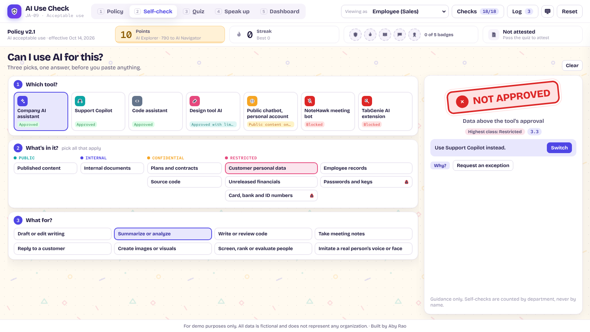

# JA-09 · AI Acceptable Use Self-Check and Quiz for Employees

Turns an AI acceptable use policy into something employees use. A **policy** with a "what can go where" table, a 15-second **self-check** ("Can I use AI for this?"), a gamified **quiz**, a **speak up** guide for when a colleague's AI use looks risky, and a **dashboard** that shows whether people know the rules, whether they follow them, and where the policy needs to change.

**For demo purposes only. All data is fictional and does not represent any organization.** Built by Aby Rao.

**Visual scheme:** 11 · Confetti Grid (warm ivory with a dot grid and sparse confetti pattern, indigo accent, sunflower for points · Bricolage Grotesque + Red Hat Mono). New in this build; added to the template's scheme list.

## How to open

Open `index.html` in any modern browser. It needs no server, no login, and no internet connection; fonts are bundled locally.

## What's inside

* **Policy:** AI Acceptable Use Policy v2.1 (8 sections, 27 clauses, five principles), the 9 × 7 "what can go where" matrix, version history, download as Markdown, print. Opening five sections earns **Policy Reader**.
* **Self-check:** pick the tool, what's in it, and what it's for. A stamp lands on **Approved**, **With conditions** or **Not approved**, with the clause, the conditions, a safer path you can apply, **Why?** (simulated AI), and **Request an exception**. +10 points per new check, up to 5 a day.
* **Quiz:** twelve real situations with points, streak bonus, hints, levels (AI Explorer, Navigator, Champion), five badges, an AI recap, a team challenge (departments only), and attestation after passing 10 of 12. Confetti on pass. Presenter mode adds **Fast-forward**.
* **Speak up:** three flip cards (Talk to them, Ask quietly, Report it). Anonymous by default, a "don't attach the data" check that blocks pasted emails, card numbers and keys, and no points for reports.
* **Dashboard:** knowing-vs-following quadrant by department, most-missed questions, why checks say no, outcomes by tool per team, the speak-up queue (security lead closes reports with a note), trending questions with an AI-drafted clarification the committee publishes as v2.2, and exception requests.
* **Everywhere:** player strip (points, level, streak, badges, attestation), persona switcher, activity log, 18 live known-answer checks, presenter mode, reset, and tooltips on hover and keyboard focus.

## Demo click path

1. **Policy:** v2.1 and the matrix. Hover **Customer personal data**: only Support Copilot gets a mark.
2. **Self-check:** **Company AI assistant** → **Customer personal data** → **Summarize or analyze**. The stamp lands **Not approved** (3.3). Click **Switch** to Support Copilot.
3. **Quiz:** answer Q1 **Approved** to see why it's wrong, then turn on presenter mode (`P`) and press **Fast-forward**: Certified, confetti, **Attest**.
4. **Speak up:** flip the three cards for **Speak-up Ally**.
5. **Dashboard:** Sales sits in "Knows it, doesn't follow it" (38% not approved, 212 of 331 NoteHawk). Customer Support sits low: an approved tool beats a quiz.
6. **Questions** tab → **Draft clarification** as Awareness lead → switch to **AI Governance Committee** → **Approve and publish v2.2**. The Policy view shows what's new. Then **Reset**.

**Keyboard:** `1`–`5` switch views · `P` presenter mode · `Esc` closes panels.

## Quality check

* `node tools/check-engine.js`: the JavaScript engine matches the Python model on all 55 comparisons (twelve self-check cases, the quiz key, five scoring runs, and every program total).
* The **Checks** panel runs 18 known-answer checks live (K1–K18 in `REQUIREMENTS.md`): 18 of 18 pass.
* Playwright drove 59 states at 1920×1080 and 1366×768 through every flow, plus presenter mode on every view:
  * self-check rules, toggles, exceptions, the safer path and **Why?**;
  * a full quiz with a wrong answer, a hint, attestation blocked and then allowed;
  * all Speak up cards, including blocked pasted data;
  * dashboard triage, the policy publish blocked and then approved, and exception decisions.
* Results: no overlapping or clipped text, nothing outside its box, no horizontal scroll, the footer always visible, and no console errors.
* A grammar scan of all visible text and tooltips checked singular and plural, with counts at 0 and 1 ("1 point", "0 badges", "1 question left", "1 report").

## Files

| Path | Purpose |
|---|---|
| `index.html` | Page structure |
| `css/styles.css` | Confetti Grid scheme, background pattern, stamp, flip and confetti animations, print styles |
| `js/data.js` | Policy, quiz and program data, wrapped from `data/*.json` |
| `js/engine.js` | Self-check rules, scoring, program aggregates (pure functions) |
| `js/app.js` | Views, quiz game, speak up, dashboard, approvals, checks, log |
| `data/` | Source JSON and expected results |
| `tools/reference_model.py` | The Python model that produced every number |
| `tools/wrap-data.js` | Wraps `data/*.json` into `js/data.js` |
| `tools/check-engine.js` | Confirms the JavaScript engine matches the Python model |
| `assets/fonts/` | Bricolage Grotesque and Red Hat Mono (SIL Open Font License) |
| `thumbnail/ja-09.png` | Self-check verdict, for promotion |
| `REQUIREMENTS.md` | Build requirements, including the full policy text |
