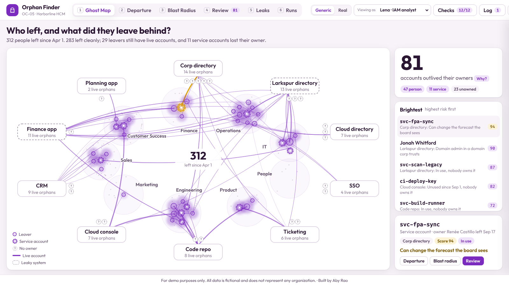

# OC-05 · Orphaned Account Finder

**Build type:** Script (with a review workflow) · **Mindset shift:** Ownership and craft · **Visual scheme:** 9 · Plum & Gold

A finder for a fictional company, Harborline HCM. It compares 312 HR terminations with two directory domains, the cloud directory, SSO and seven apps, finds 81 accounts that outlived their owners (including 11 service accounts whose owner left), shows what each can reach in business terms, and closes them after a quick one- or two-person review. Then it shows why orphans keep appearing and which upstream fix stops them.

**For demo purposes only. All data is fictional and does not represent any organization.**

## How to open

Open `index.html` in a browser. No server, no login, no network. Fonts are bundled.

## Demo click path (about 90 seconds)

1. **Ghost Map (1):** watch the ghosts fade in and their tethers light up. 81 accounts outlived their owners.
2. Click the gold gear: **svc-fpa-sync**. Its owner left 41 days ago; it still signs in every Sunday.
3. **Blast radius:** the account reaches the Q4 forecast the board reviews on Nov 5. Click **Why?** on the score of 94.
4. **Review:** keep **Reassign** with Aisha Rahman, press **Enter** as Lena (IAM analyst), click **Switch to Dana Kim**, press **Enter** again. Owner set, password rotated (simulated).
5. **Review batch** → switch back to Lena → **Approve 36 accounts** → **Run now**. 36 verified, one finance account comes back "Not removed".
6. **Leaks (5):** 17 of 47 orphans come from two systems the HR feed doesn't reach. **Switch to Alex** (Deputy CISO) → **Accept fix** on both.
7. **Runs (6):** the dashed line shows the projected drop with both fixes.

Other good stops: **Jonah Whitford** (domain admin in the acquired domain, 58 days), **Denise Albright** (can create and approve vendor payments), **Marcus Reyes** (exported a customer report 5 days after leaving), and **chrismorgan** in the cloud console (name-only match; confirm the person first).

## Keyboard

`1`–`6` views · `P` presenter mode · In Review: `D` disable, `R` reassign, `O` find owner, `K` keep, `C` confirm match, `Enter` approve, `←` `→` previous and next · `Esc` closes dialogs.

## What's inside

| Path | Purpose |
|---|---|
| `index.html` | Page structure |
| `css/styles.css` | Plum & Gold scheme |
| `js/engine.js` | Matching, classification, scoring, medians. Pure functions; runs under Node |
| `js/checks.js` | Known-answer checks, shared by the browser and Node |
| `js/core.js` | State, approvals, simulated actions, verification runs, log |
| `js/view-*.js` | Ghost Map, Departure, Blast Radius, Review, Leaks, Runs |
| `js/data.js` | Generated by `tools/build-data.js` (browsers block `fetch()` from `file://`) |
| `data/seed.json` | The same data as JSON |
| `tools/build-data.js` | Seeded generator for the fictional HR and account records |
| `tools/run-checks.js` | Runs the known-answer checks: `node tools/run-checks.js` |
| `REQUIREMENTS.md` | Build answers, rules and known answers |
| `assets/fonts/` | Outfit and Fira Code (SIL Open Font License) |

## Checks

**Checks** in the top bar runs 12 checks live: K1 to K10 from `REQUIREMENTS.md`, plus totals (47 person · 11 service · 23 unowned) and leak sources (17 of 47; medians 34 days and same day).

## Assumptions

* Volumes, removal delays and run history are seeded values, not measurements.
* All actions are simulated: nothing connects to a directory, app or vault.
* The flagged finance account fails its first removal on purpose, to show verification.
* Upstream fixes only project a trend. They don't change today's findings.
* "Generic" names are the default; **Real** swaps in product names for the same fictional data.
